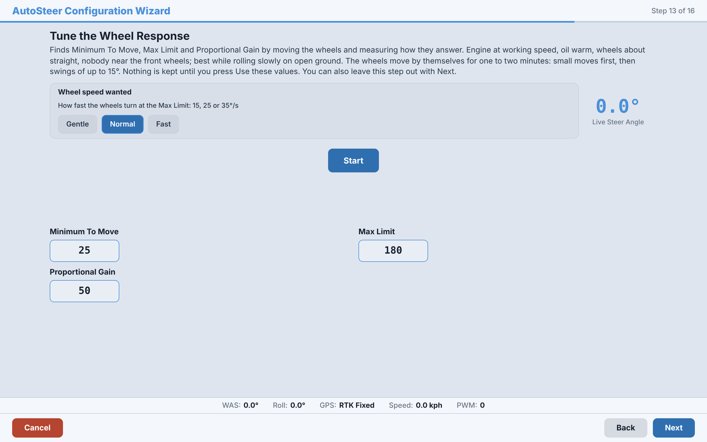

The **Steer Wizard** takes you through the whole AutoSteer setup in order. It
asks for the tractor's measurements, then runs the calibration tests one at a
time and fills in the results for you.

Start it from **Tools** on the left bar, then **Steer Wizard**. It is also at
the bottom of the full [AutoSteer panel](/software/setup/autosteer/).

## Before you start

- Make a [vehicle profile](/software/setup/profiles/) for this tractor and
  load it. The wizard saves into the profile in use.
- Park on **level ground** with room to drive in circles: an empty yard or a
  stubble field.
- The GPS should have a position, with **RTK Fixed** if you can. The circle
  tests measure with it.
- The steer module must be answering: check
  [Network IO](/software/connect/network-io/).
- Turn the [simulator](/software/simulator/) off. The tests need the real GPS
  and the real steering.

:::danger[The steering moves by itself]
Two of the tests turn the steering wheel by themselves, one of them to full
lock on both sides. Keep hands, arms and loose clothing away from the
wheel, and keep people away from the front wheels.
:::

## How it works

The line at the bottom shows live readings all the way through: the wheel
angle (**WAS**), **Roll**, the **GPS** quality, **Speed**, and the power going
to the motor (**PWM**).

**Next** and **Back** move between steps. A test step can be skipped, and the
last page lists the tests you did not run. **Cancel** closes the wizard.

If your steer module has a steer switch, it must be on for the tests that move
the wheels. The wizard tells you when it is not.

The wizard closes by itself if the screen in control stops answering, for
example when the tablet goes to sleep. Open it again to go on.

## The steps

There are 16. With **GPS Only** chosen in step 3, the steering steps are left
out.

### 1 to 5: the tractor

1. **Welcome.**
2. **Vehicle Type**: tractor, harvester, or 4WD / articulated.
3. **Hardware Installed**:
   - **GPS Only**: you steer yourself by the light bar.
   - **AutoSteer**: a steering motor or valve, a wheel angle sensor and an IMU.
   - **Full Setup**: AutoSteer and section control.
4. **Vehicle Dimensions**: wheelbase and track width.
5. **Antenna Position**: pivot distance, height and offset.

How to measure these is on the [Vehicle](/software/setup/vehicle/) page. Take
care with the wheelbase and the track width: the circle tests in steps 11 and
12 work the steering angle out from them.

The offset here is only a side: **Left**, **Center** or **Right**. **Center**
sets it to 0. **Left** or **Right** keeps the distance you had and puts it on
that side, or 0.5 m if it was 0. Type the distance you measured on the Vehicle
page.

### 6: Hardware Configuration

| Setting                   | Choose                                                                       |
| ------------------------- | ---------------------------------------------------------------------------- |
| Steer enable method       | **None**, a **Switch** or a **Button** wired to the steer module             |
| Motor driver              | **IBT2** or **Cytron**, whichever your board has                             |
| A/D converter             | **Differential** or **Single**, to match how the wheel angle sensor is wired |
| Invert steer enable relay | For a relay that works the other way round                                   |
| Danfoss valve             | On for a Danfoss proportional steering valve                                 |

If you do not know, see the page for your board in the
[Hardware](/hardware/) section.

### 7: Roll Calibration

1. Tilt the tractor a little to the right. The gauge should move to the right.
   If it moves left, switch **Invert roll** on.
2. Park on level ground and tap **Zero Roll**.

If the roll reads more than 5° from level, the wizard asks whether the ground
really is level. Tap **Zero Roll** again within 15 seconds to confirm.

### 8: Wheel Angle Sensor

1. Point the wheels straight ahead. Driving forward a few metres with the
   wheel held straight is the surest way.
2. Tap **Zero WAS**.
3. Turn the wheels to the **right**. The angle should be positive. If it is
   negative, switch **Invert WAS** on.

As with the roll, a reading more than 10° from zero must be confirmed with a
second tap within 15 seconds. If the zero would need more than 3900 counts of
offset, the wizard refuses it: check how the sensor is mounted.

### 9: Auto Motor Calibration

**The steering moves.** Tap **Start Motor Test** and keep clear. The wizard
asks for a turn of 5° and raises the power step by step until the wheels move
at least 1°. From that it finds:

- which way the motor turns, and sets **Invert motor** if needed,
- the least power that moves the wheels (**Minimum PWM**).

If the wheels only moved at two thirds of the maximum power or more, they were
held: the wizard keeps the old **Minimum PWM** and says so. Free the wheels and
run the test again.

If the wheels do not move at all, check that nothing is holding them, that the
motor is engaged, and its power supply. If the wheel moves more than 15° from
where it started, the test stops by itself: check the wheel angle sensor first.
If the wheels turn the wrong way both ways round, the motor wires are swapped
or **Invert WAS** in step 8 is wrong.

### 10: Maximum Steering Angle

**The steering moves to full lock**, right then left. Tap **Start Max Angle
Test** and keep clear. On a tractor whose steering is heavy when standing
still, do it with the engine at idle on level ground.

The wizard takes 90 % of the smaller of the two locks, so AutoSteer never
pushes against the tighter stop. That is the largest angle AutoSteer will ask
for. The test gives each side 6 seconds. If the wheels do not reach the lock
in that time, type the angle later in the AutoSteer panel, under **Steering
Sensor**, **Max Steer Angle**.

If the wheels turn the wrong way, go **Back** and run the motor test first.

### 11: CPD Circle Test

This finds **counts per degree**: how much the sensor's reading changes for
one degree of wheel angle.

1. Turn the steering wheel about 20° to the **right** and hold it still.
2. Drive in a steady circle at about 5 km/h. **Record** works only once you
   are moving.
3. Tap **Record** and keep the circle going.

AgOpenWeb measures the circle from the GPS and stops by itself when the circle
stops growing. It then shows the new value, the circle, the angle it worked
out and what the sensor read. The value is taken 10 % low on purpose, as
AgOpenGPS does, so AutoSteer steers a little less hard rather than too hard.

The test gives no result, and leaves the value as it was, when:

- less than half a circle was driven, or the tractor stopped,
- the wheel moved more than 3° during the circle,
- the circle was to the left,
- the sensor read less than 2°.

With a fix below **RTK Fixed**, it says so: the result may be off.

### 12: Ackermann Calibration

The same again to the **left**: about 20°, a steady circle, **Record**. This
corrects for the inner and outer wheels turning by different amounts, so the
sensor reads the same angle to the left as to the right. Do it after the CPD
test, as it builds on that value.

While it measures, **Ackermann** is set to 100, which is neutral. The result
lies between 0 and 200. **Stop** before the end leaves the value as it was.

### 13: Tune the Wheel Response

This step is optional. It finds three settings by moving the wheels and
measuring how they answer, instead of you trying values by hand:

- **Minimum To Move**: the least power that moves the wheels.
- **Max Limit**: the most power the module uses.
- **Proportional Gain**: how hard the module drives the wheels towards the angle
  asked for.

Leave it out with **Next** if you would rather set them yourself on the
AutoSteer page.

Before you tap **Start**:

- Engine at working speed, oil warm, the wheels about straight (within 8°),
  and nobody near the front wheels.
- The tractor still, or rolling at walking pace on open ground. Above 6 km/h it
  will not start, and above 10 km/h it stops.
- Your own **Max Limit** typed in. The test never drives above it, because only
  you know what your valve's coil or your motor can take.

Choose **Wheel speed wanted**: how fast the wheels should turn at the Max Limit.
**Gentle** is 15°/s, **Normal** 25°/s and **Fast** 35°/s.

1. **Start** runs the **stop check**. Before anything moves by itself, stop
   the module once at the wheel: turn the steering wheel by hand if you have a
   kickout sensor, or switch the steer switch off. With no switch, button or
   sensor set up, the only stop is the **Stop** button on the page, and the
   page says so. Then tap **Continue**.
2. The wheels move by themselves for one to two minutes: small moves first,
   then swings of up to 15°. The page says what it is measuring:
   - **Minimum To Move**: the power at which the wheels first move, to the
     right and to the left. The setting is a little under the lower of the two.
   - **Max Limit**: how fast the wheels turn at rising power, until they turn as
     fast as you chose, or more power turns them no faster. Then it takes the
     lowest power that gives 90 % of their top speed: more would only heat a
     coil or a motor.
   - **Proportional Gain**: small turns at a rising gain. It takes the lowest
     gain that settles about as fast as the best one without going past the
     target, and checks it with 8° turns.
3. The result shows each setting, old and new, and how the wheels turned.
   **Use these values** puts them in use; **Keep the old values** leaves yours.
   Nothing changes until you choose, and **Finish** saves them with the
   vehicle. **Measurements** under the result shows the numbers behind it.

The test stops by itself, and puts your own values back, when:

- the wheels go more than 22° from where they started, or turn the wrong way.
  Run the motor test (step 9) first: it finds the motor direction;
- the module stops steering: the steer switch off, or a kickout;
- the wheels stop answering: a hand on the wheel, or the wheels against a stop;
- you tap **Stop**, leave the step, or close the wizard.

Afterwards, set **Steer Response** on a line with AutoSteer on: see
[AutoSteer settings](/software/setup/autosteer/).

### 14: Steering Gains

Starting values for how the tractor follows the line:

- **Guidance algorithm (Stanley)**: off is Pure Pursuit, a good start. Stanley
  is more responsive at low speed.
- **Proportional gain (Kp)**: how hard the steering corrects. Start at 10, or
  keep the value step 13 found.
- **Integral gain (Ki)**: corrects a steady drift. Start at 0.
- **Steer response hold**: how far ahead it looks. Higher is smoother.
- **Side hill compensation**: degrees of steering per degree of roll.

Leave them as they are the first time, and tune them afterwards while driving:
see [AutoSteer settings](/software/setup/autosteer/).

### 15: Speed and Sensors

- **Min steer speed** and **Max steer speed**: AutoSteer works only between
  these.
- **Turn Sensor**, **Pressure sensor**, **Current sensor**: switch on the one
  your tractor has. It lets you take over by turning the wheel.
- **Steer in reverse**: allow AutoSteer while backing up.
- **Deadzone heading**: a steering error smaller than this is left alone, so
  the motor rests. See
  [Deadzone and timing](/software/setup/autosteer/#deadzone-and-timing).

### 16: Setup Complete

The page lists any tests you skipped. Tap **Finish** to save everything into
the vehicle profile.

## Afterwards

Make a guidance line in a field and try it at walking pace. If the tractor
holds the line a steady distance to one side, run
[Smart WAS](/software/setup/smart-was/). If it wanders or is slow to settle,
see [AutoSteer settings](/software/setup/autosteer/).

You can run the wizard again at any time, and skip to the step you want to
repeat.
